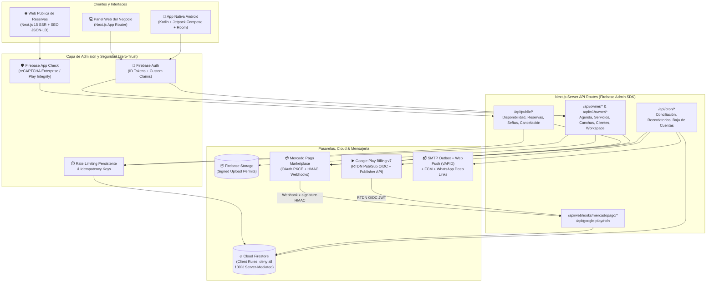

<div align="center">

  

  <h1>Pediturno — Open-Source Multi-Vertical Booking & Scheduling SaaS Platform</h1>

  <p>
    <strong>Sistema de Turnos Online, Reservas con Seña (Mercado Pago Marketplace OAuth + HMAC), Agenda Multi-Rubro y App Nativa Android (Jetpack Compose)</strong>
  </p>

  <p>
    <a href="#-instalación-y-configuración-paso-a-paso"></a>
    <a href="#-app-nativa-android-jetpack-compose"></a>
    <a href="#-arquitectura-de-seguridad-zero-trust"></a>
    <a href="#-cobro-de-señas-y-mercado-pago-marketplace"></a>
    <a href="LICENSE"></a>
  </p>

  <p>
    <a href="https://cafecito.app/digitalmenteseguro">
      
    </a>
  </p>

  <p>
    <a href="#-para-qué-sirve-y-qué-problemas-resuelve">¿Para qué sirve?</a> •
    <a href="#-arquitectura-del-sistema">Arquitectura</a> •
    <a href="#-características-principales">Características</a> •
    <a href="#-instalación-y-configuración-paso-a-paso">Instalación</a> •
    <a href="#-variables-de-entorno-env">Configuración (.env)</a> •
    <a href="#-app-nativa-android-jetpack-compose">App Android</a> •
    <a href="https://cafecito.app/digitalmenteseguro">☕ Donar un Cafecito</a>
  </p>

</div>

---

<div align="center">
  <table>
    <tr>
      <td align="center">
        <br/>
        <sub><b>Vertical 1: Servicios y Profesionales</b><br/>Barberías, estética, consultorios, estudios</sub>
      </td>
      <td align="center">
        <br/>
        <sub><b>Vertical 2: Complejos Deportivos</b><br/>Canchas de fútbol, pádel, tenis</sub>
      </td>
      <td align="center">
        <br/>
        <sub><b>Vertical 3: Espacios, SUM y Alquileres</b><br/>Quinchos, salas de ensayo, coworking</sub>
      </td>
    </tr>
  </table>
</div>

---

## ☕ ¿Te sirve este código? ¡Apoyá el desarrollo Open-Source!

Este proyecto reúne **miles de horas de ingeniería de software en producción**: arquitectura web full-stack en Next.js 15, aplicación Android nativa en Kotlin/Jetpack Compose con soporte para páginas de memoria de 16 KB (Android 15+), integración de pagos reales con Mercado Pago Marketplace OAuth, facturación con Google Play Billing + RTDN (Pub/Sub OIDC) y más de **280 tests automatizados** de seguridad e integración.

Si este repositorio te ahorra semanas de trabajo, te sirve para aprender arquitectura limpia o lo usás como base para tu próximo SaaS o proyecto universitario/comercial, **podés apoyar al autor invitando un Cafecito**:

<div align="center">
  <a href="https://cafecito.app/digitalmenteseguro" target="_blank" rel="noopener noreferrer">
    
  </a>
  <br/><br/>
  👉 <strong><a href="https://cafecito.app/digitalmenteseguro">https://cafecito.app/digitalmenteseguro</a></strong>
</div>

---

## 🎯 ¿Para qué sirve y qué problemas resuelve?

**Pediturno** es una plataforma SaaS **multi-vertical (multi-tenant)** lista para producción que permite a cualquier negocio, profesional o complejo deportivo gestionar su agenda y recibir reservas online las 24 horas desde un enlace público personalizado (`tudominio.com/nombre-negocio`), sin obligar al cliente final a descargar aplicaciones ni registrarse.

### Problemas reales que resuelve:
1. **Eliminación de huecos e inasistencias (No-Shows):** Permite configurar el cobro automático de **señas o anticipos** mediante **Mercado Pago Marketplace (OAuth)**. El dinero va directo a la cuenta de Mercado Pago del comercio sin pasar por cuentas intermediarias manuales.
2. **Bloqueo atómico de horarios (Anti-Overbooking):** Implementa bloqueos transaccionales en servidor sobre slots de reserva (`bookingSlots`) con llaves de idempotencia (`X-Idempotency-Key`), evitando que dos clientes reserven el mismo turno al mismo milisegundo.
3. **Multi-Vertical Nativo en una sola base de código:**
   - 💈 **Servicios (`services`):** Turnos por duración, profesional, feriados, bloqueos por fecha y buffers entre turnos.
   - ⚽ **Canchas (`sports_facility`):** Grilla de turnos por deporte (Pádel, Fútbol 5/7/11, Tenis), franjas nocturnas/diurnas y precios diferenciados.
   - 🏢 **Espacios (`spaces`):** Reservas por bloque horario, turno o jornada completa para SUM, quinchos, estudios fotográficos y salas.
4. **Arquitectura Offline-Read & Server-Authoritative en Android:** Incluye la aplicación móvil nativa para dueños de negocios construida siguiendo la arquitectura canónica de Google (*Now in Android* — UDF / MVI, Jetpack Compose, Material 3, Room Offline Cache + Server Mutations).

---

## 🏗️ Arquitectura del Sistema



---

## ✨ Características Principales

<table>
  <tr>
    <td width="50%" valign="top">
      <h3>🛡️ Seguridad Zero-Trust en Base de Datos</h3>
      <ul>
        <li><b>Firestore 100% cerrado al cliente (<code>allow read, write: if false</code>):</b> Ningún navegador ni APK puede leer o modificar colecciones directamente. Toda operación pasa por endpoints de servidor validados con Firebase Admin SDK.</li>
        <li><b>Proyección pública sanitizada (<code>publicBusinesses</code>):</b> Los clientes que reservan jamás reciben correos internos, tokens ni metadatos privados del dueño.</li>
        <li><b>Permisos criptográficos de subida de imágenes:</b> Validación de cuota, MIME type y limpieza automática de archivos huérfanos en Cloud Storage.</li>
      </ul>
    </td>
    <td width="50%" valign="top">
      <h3>💳 Cobro de Señas y Mercado Pago Marketplace</h3>
      <ul>
        <li><b>Vinculación OAuth 2.0 segura:</b> Cada comercio conecta su propia cuenta de Mercado Pago.</li>
        <li><b>Cifrado AES-256-GCM en reposo:</b> Los <code>access_token</code> y <code>refresh_token</code> de los comercios se almacenan cifrados en Firestore con rotación automática.</li>
        <li><b>Verificación HMAC-SHA256 (<code>x-signature</code>):</b> Validación en tiempo constante (<code>timingSafeEqual</code>), protección anti-replay y conciliación automática por cron.</li>
      </ul>
    </td>
  </tr>
  <tr>
    <td width="50%" valign="top">
      <h3>📱 App Nativa Android (Jetpack Compose)</h3>
      <ul>
        <li><b>Ubicación:</b> <code>android/pediturno-servicios</code></li>
        <li><b>Arquitectura UDF / MVI:</b> <code>StateFlow&lt;UiState&gt;</code>, <code>SharedFlow&lt;UiEvent&gt;</code>, <code>Room</code> como caché de lectura offline (<code>isOfflineCache = true</code>) y mutaciones 100% autoritativas en servidor.</li>
        <li><b>Google Play Billing Library:</b> Suscripciones verificadas en servidor contra la API de Google Play Developer + notificaciones en tiempo real RTDN.</li>
        <li><b>Exportación nativa:</b> Generación de agenda en PDF y directorio de clientes en CSV con integración de Google Play In-App Review.</li>
      </ul>
    </td>
    <td width="50%" valign="top">
      <h3>📬 Notificaciones, Calendario y Cumplimiento</h3>
      <ul>
        <li><b>Outbox Transaccional de Emails (SMTP):</b> Confirmaciones, reprogramaciones y cancelaciones con enlaces de capacidad firmados (capability tokens) y archivos <code>.ics</code> (Google/Apple Calendar).</li>
        <li><b>Notificaciones Push:</b> Web Push (VAPID) en navegador y Firebase Cloud Messaging (FCM) en Android.</li>
        <li><b>Cumplimiento de Baja de Cuenta (Google Play Policy):</b> Flujo completo de solicitud y ejecución de baja de cuenta desde la app y la web, con anonimización de PII y preservación de libros contables.</li>
      </ul>
    </td>
  </tr>
</table>

---

## 📂 Estructura del Proyecto

```text
├── android/
│   └── pediturno-servicios/        # Proyecto Android nativo (Kotlin, Jetpack Compose, Room, Play Billing)
│       ├── app/src/main/           # Código fuente Android (UI, ViewModels, Repositorios, Red)
│       └── app/google-services.example.json
├── functions/                      # Configuración base para Firebase Cloud Functions (opcional)
├── public/                         # Assets estáticos, íconos PWA, manifest, Digital Asset Links
├── scripts/                        # Scripts de mantenimiento, cron jobs, auditoría y emuladores
├── security/                       # Reglas adicionales de permisos de Storage
├── src/
│   ├── app/
│   │   ├── [slug]/                 # Página pública de reservas SSR con JSON-LD y OpenGraph
│   │   ├── api/                    # Backend completo en Next.js Route Handlers
│   │   │   ├── admin/              # Endpoints administrativos protegidos
│   │   │   ├── auth/mercadopago/   # Flujo OAuth de Mercado Pago Marketplace
│   │   │   ├── cron/               # Trabajadores de conciliación, recordatorios y bajas
│   │   │   ├── google-play/        # Verificación de suscripciones Play Store y webhook RTDN
│   │   │   ├── owner/              # API privada para gestión del negocio (Web)
│   │   │   ├── public/             # API pública de disponibilidad, reservas y señas
│   │   │   ├── v1/owner/           # API REST versionada e idempotente para la App Android
│   │   │   └── webhooks/           # Receptores HMAC de Mercado Pago
│   │   ├── cancel/[id]/            # Portal de autogestión/cancelación de turno para clientes
│   │   ├── dashboard/              # Panel de control del negocio (Calendario, Clientes, Servicios, Pagos)
│   │   ├── faq/ & privacy-policy/  # Páginas informativas y legales
│   │   └── pago/[orderId]/         # Pantalla de estado de pago de seña
│   ├── components/                 # Componentes React + Tailwind CSS + Radix UI (shadcn/ui)
│   ├── context/ & hooks/           # Estado del dashboard, autenticación y onboarding
│   ├── lib/                        # Lógica de dominio (disponibilidad, cuotas, pagos, criptografía)
│   ├── services/                   # Adaptadores de Firebase, SMTP, Mercado Pago y Web Push
│   └── tests/                      # +95 suites de tests unitarios y de integración con emulador
├── tests/                          # Tests de reglas de seguridad de Firestore
├── .env.example                    # Plantilla documentada de todas las variables de entorno
├── firebase.json                   # Configuración de Firebase (Firestore, Storage, Auth, Emulators)
├── firestore.indexes.json          # Índices compuestos de Cloud Firestore
├── firestore.rules                 # Reglas Zero-Trust de Firestore
└── storage.rules                   # Reglas de seguridad de Cloud Storage
```

---

## 🚀 Instalación y Configuración Paso a Paso

### 1. Requisitos Previos
- **Node.js** `>= 20.x` (recomendado `22 LTS`) y **npm**.
- **Java JDK 17** y **Android Studio Ladybug / Meerkat** (solo si deseás compilar la app Android).
- Una cuenta gratuita de **[Firebase](https://console.firebase.google.com/)** (con Authentication, Firestore y Storage habilitados).
- *(Opcional)* Una cuenta de desarrollador en **[Mercado Pago Developers](https://www.mercadopago.com.ar/developers)** para cobro de señas.

### 2. Clonar el Repositorio e Instalar Dependencias

```bash
git clone https://github.com/facuquilmes123/pediturno-open-source.git
cd pediturno-open-source
npm install
```

### 3. Configurar Firebase
1. Creá un nuevo proyecto en [Firebase Console](https://console.firebase.google.com/).
2. Habilitá **Authentication** (proveedores: *Correo electrónico/Contraseña* y *Google*).
3. Creá una base de datos **Cloud Firestore** en modo producción y un bucket de **Cloud Storage**.
4. Actualizá el archivo `.firebaserc` con el ID de tu proyecto:
   ```json
   {
     "projects": {
       "default": "tu-proyecto-firebase"
     }
   }
   ```
5. Desplegá las reglas e índices de Firestore y Storage:
   ```bash
   npx firebase-tools deploy --only firestore:rules,firestore:indexes,storage
   ```
6. En *Configuración del proyecto → Cuentas de servicio*, generá una nueva clave privada JSON y codificá su clave privada en Base64 para la variable `GCLOUD_PRIVATE_KEY_BASE64`.

---

## 🔐 Variables de Entorno (`.env`)

Copiá el archivo de plantilla `.env.example` a `.env`:

```bash
cp .env.example .env
```

A continuación se detallan los grupos de variables (todas documentadas en [`.env.example`](.env.example)):

| Grupo | Variables Clave | Descripción |
| :--- | :--- | :--- |
| **Firebase Web (Públicas)** | `NEXT_PUBLIC_FIREBASE_API_KEY`<br/>`NEXT_PUBLIC_FIREBASE_AUTH_DOMAIN`<br/>`NEXT_PUBLIC_FIREBASE_PROJECT_ID`<br/>`NEXT_PUBLIC_FIREBASE_APP_ID` | Credenciales públicas del SDK web de Firebase y origen de la aplicación (`NEXT_PUBLIC_APP_ORIGIN`). |
| **Firebase Admin (Servidor)** | `FIREBASE_PROJECT_ID`<br/>`GCLOUD_CLIENT_EMAIL`<br/>`GCLOUD_PRIVATE_KEY_BASE64` | Cuenta de servicio utilizada por los Route Handlers de Next.js para operar sobre Firestore y verificar tokens. |
| **Seguridad y Criptografía** | `BOOKING_CAPABILITY_OUTBOX_KEY`<br/>`BOOKING_OUTBOX_SECRET`<br/>`CRON_SECRET`<br/>`ACCOUNT_DELETION_WORKER_KEY` | Claves de 32 bytes en Base64 (`openssl rand -base64 32`) para firmar tokens de reserva, cifrar credenciales OAuth y autenticar cron jobs. |
| **Email (SMTP) y Web Push** | `EMAIL_HOST`, `EMAIL_PORT`, `EMAIL_USER`, `EMAIL_PASS`<br/>`NEXT_PUBLIC_VAPID_PUBLIC_KEY`, `VAPID_PRIVATE_KEY` | Servidor SMTP para envío de confirmaciones y par de llaves VAPID (`npx web-push generate-vapid-keys`) para notificaciones push en navegador. |
| **Mercado Pago Marketplace** | `MP_MARKETPLACE_APP_ID`<br/>`MP_MARKETPLACE_CLIENT_SECRET`<br/>`MP_MARKETPLACE_WEBHOOK_SECRET`<br/>`MP_TOKEN_ENCRYPTION_KEY` | Credenciales OAuth de tu aplicación Marketplace en Mercado Pago y secreto HMAC para validar webhooks en `/api/webhooks/mercadopago/marketplace`. |
| **Google Play Billing** | `GOOGLE_PLAY_PACKAGE_NAME`<br/>`GOOGLE_PLAY_MONTHLY_BASE_PLAN_ID`<br/>`GOOGLE_PLAY_SERVICE_ACCOUNT_JSON_BASE64` | Configuración para verificar compras de suscripciones desde la app Android contra la API oficial de Google Play Developer. |

### Ejecutar en Modo Desarrollo

```bash
npm run dev
```

La aplicación web estará disponible en `http://localhost:3000`.

---

## 🧪 Ejecutar la Suite de Tests

El proyecto cuenta con más de **95 archivos de test** (Vitest + Testing Library + Firebase Emulator Suite):

```bash
# Ejecutar tests unitarios y de rutas de API
npm test

# Verificar tipado estático de TypeScript
npm run typecheck

# Compilar build de producción de Next.js
npm run build
```

---

## 📱 App Nativa Android (Jetpack Compose)

El código fuente completo de la aplicación Android se encuentra en [`android/pediturno-servicios`](android/pediturno-servicios).

1. Copiá el archivo de plantilla `google-services.example.json`:
   ```bash
   cp android/pediturno-servicios/app/google-services.example.json android/pediturno-servicios/app/google-services.json
   ```
   *(Reemplazalo por el `google-services.json` descargado desde tu proyecto de Firebase para el paquete `com.pediturno.servicios`).*
2. Configurá tu `google_server_client_id` en `android/pediturno-servicios/app/src/main/res/values/strings.xml`.
3. Abrí la carpeta `android/pediturno-servicios` en **Android Studio** o compilá por línea de comandos:
   ```bash
   cd android/pediturno-servicios
   ./gradlew assembleDebug testDebugUnitTest
   ```

---

## ⏰ Tareas Programadas (Cron Jobs en Producción)

En producción (VPS, Hostinger, Railway, Render o Vercel Cron), el sistema incluye dos runners en `scripts/` que podés programar cada 5 minutos:

1. **Conciliación de pagos, recordatorios y outbox de correos:**
   ```bash
   node --env-file=.env scripts/hostinger-cron.mjs
   ```
2. **Procesador de solicitudes de baja de cuenta y anonimización:**
   ```bash
   node --env-file=.env scripts/hostinger-account-deletion.mjs
   ```

---

## 🤝 Contribuir y Apoyar el Proyecto

Las contribuciones, *issues* y *pull requests* son bienvenidas. Revisá [CONTRIBUTING.md](CONTRIBUTING.md) y nuestra política de seguridad en [SECURITY.md](SECURITY.md).

Si este proyecto te ayudó a lanzar tu emprendimiento, aprender Next.js + Firebase + Android Compose o integrar Mercado Pago de forma segura:

1. ⭐ **Dejale una estrella (Star) a este repositorio en GitHub** (¡ayuda muchísimo a que más desarrolladores lo encuentren!).
2. ☕ **Invitame un Cafecito en:** **[https://cafecito.app/digitalmenteseguro](https://cafecito.app/digitalmenteseguro)**

<div align="center">
  <br/>
  <a href="https://cafecito.app/digitalmenteseguro" target="_blank" rel="noopener noreferrer">
    
  </a>
  <br/><br/>
  <sub>Desarrollado con ❤️ y estándares de seguridad de grado producción. Distribuido bajo licencia <a href="LICENSE">MIT</a>.</sub>
</div>
